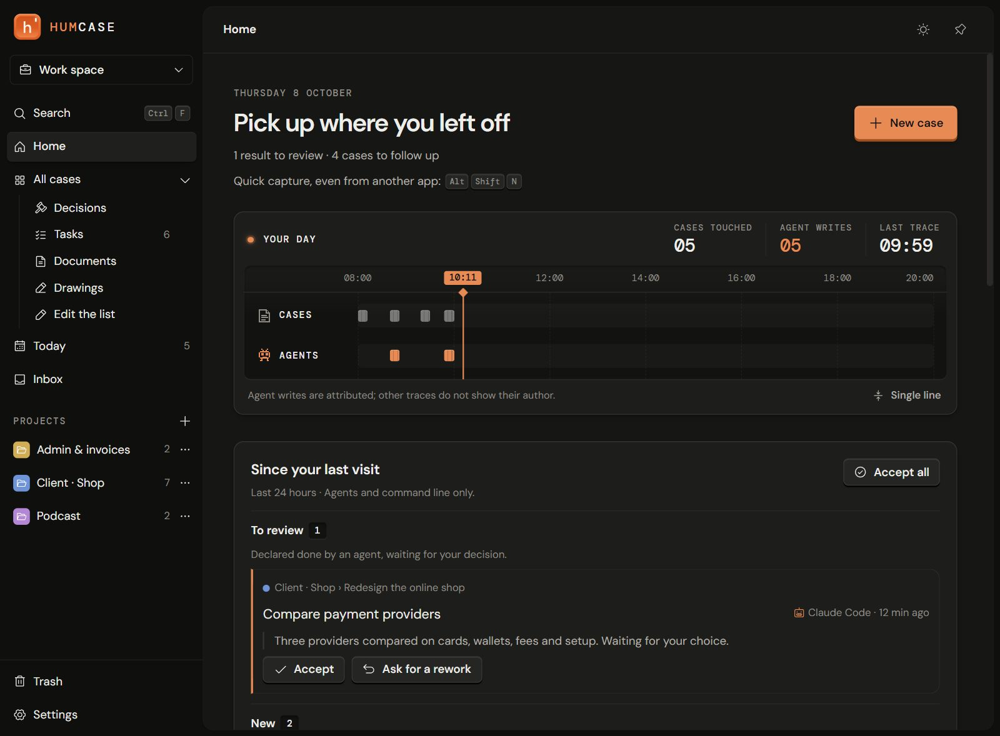

# Humcase

[](https://github.com/humcase/humcase/actions/workflows/ci.yml)
[](https://github.com/humcase/humcase/releases/latest)
[](LICENSE)

Track your ideas, tasks and decisions, and the work your agents hand in.

Humcase is a Windows app for writing, organizing and following your work in **cases**, for work and personal use. It works without AI and without an account; your data stays on your computer. AI agents connect through MCP and hand in results that you accept or send back.



**[Download for Windows](https://github.com/humcase/humcase/releases/latest/download/Humcase-setup-x64.exe)** (Windows 10 and 11) · [Website](https://humcase.com) · [All releases](https://github.com/humcase/humcase/releases)

Status: preview (0.9.x). The installer isn't signed yet, so Microsoft Defender SmartScreen shows a warning: click **More info**, then **Run anyway**.

## What it does

- **Cases and sub-cases** on a canvas, a board, cards or a list, with drawings, images, links and tables inside a case.
- **Projects, spaces (Work, Personal) and an Inbox** to file what you capture; quick capture with `Alt+Shift+N` from any app.
- **Results and decisions**: an agent declares a result, you accept it or ask for a rework, with your reason kept.
- **Home** shows your day, what agents did since your last visit and the case to pick up.
- **Optional AI**: voice dictation, Structure and Sprout (next steps proposed as sub-cases) with your own API key or a model on your computer.
- **Search by meaning**, on your computer, with a small built-in model.
- **Backups** to a single `.humcase.zip` archive, and a 30-day trash.
- Interface in English and French, with Spanish, German, Portuguese (Brazil) and Italian in beta.

Full list: [FEATURES](docs/FEATURES.md).

## For agents

`Humcase.exe mcp` runs an MCP server on the same database as the app, and `Humcase.exe call <tool>` runs the same tools from a terminal. The Claude Code plugin adds the server and four skills:

```bash
claude plugin marketplace add humcase/humcase
claude plugin install humcase@humcase
```

Setup for Claude Code, the Claude desktop app, Codex, opencode and other clients: [AGENT_SETUP](docs/AGENT_SETUP.md). Tools and permissions: [MCP_SPEC](docs/MCP_SPEC.md).

## Where is the data?

Everything lives in `%USERPROFILE%\.humcase`, never in AppData: the database `humcase.db`, the pasted images in `images\`, and the rebuildable indexes. Backup archives go to `Documents\Humcase Backups`. Details: [FEATURES](docs/FEATURES.md#restoring-from-an-archive).

## Building from source

Prerequisites: Windows, [Rust](https://www.rust-lang.org/) 1.89 or later with the MSVC toolchain, Node.js 24 and the WebView2 runtime.

1. `npm install` at the root and in `frontend/`.
2. `npm run tauri dev` for development.
3. `npm run update-exe` to build `Humcase.exe` and the search-by-meaning worker next to it (the first build downloads about 175 MB of pinned runtime and model).

Linux builds (AppImage, `.deb`) are experimental and built in Docker: see [CONTRIBUTING](docs/CONTRIBUTING.md).

Stack: Rust, Tauri 2, SQLite, React 19, TypeScript, Tailwind CSS, Tiptap. Search by meaning runs Granite Embedding 97M multilingual R2 (IBM, Apache 2.0) with ONNX Runtime.

## Contributing, security, license

- [CONTRIBUTING](docs/CONTRIBUTING.md): checks, isolated test profile, and the [Contributor License Agreement](CLA.md) signed once in your first pull request.
- [SECURITY](SECURITY.md): report a vulnerability privately.
- [CODE_OF_CONDUCT](CODE_OF_CONDUCT.md).
- Documentation index: [docs](docs/README.md).
- License: [AGPL-3.0-only](LICENSE). The Humcase name and logo are not covered by the code license.
