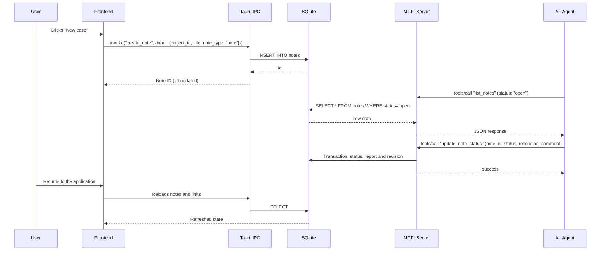

# Humcase Architecture

## Main Components

### 1. Tauri 2 (the "Bridge")
Tauri manages the native Windows window (WebView2) and security.
- **IPC commands**: Exposes Rust functions to the frontend (`create_note`, `get_projects`), called only from `frontend/src/services/tauriApi.ts`; a test (`tauriApi.contract.test.ts`) checks every call's argument names against the Rust command parameters, since Tauri drops an unknown argument silently.
- **Engine texts**: what Rust shows to the person (errors, menus, brief) comes from `engine.json` beside the interface's language files, embedded in the binary (`i18n.rs`); the interface bundle does not carry them. A database failure that comes from outside Humcase (file held by another program, read-only folder, full disk, damaged file) is told through `db::db_error`; any other keeps SQLite's text, which names the rule that refused the write. MCP and CLI answer in English.
- **Binary**: the crate builds `humcase.exe` (delivered as `Humcase.exe`); the same binary is the interface, `Humcase.exe mcp` and the CLI.
- **Windows window**: WebView2 displays the interface; consumption depends on the machine and the open views.
- **AI calls on the Rust side**: LLM cleanup (`clean_transcript`), structuring (`structure_note`) and the Deepgram connection (`start_transcription`) run in the Rust process. Saved keys or keys from the environment are never sent back to the frontend. A new key entered in the settings travels temporarily through the WebView and is then passed to Rust to be saved; only its state and origin are then exposed to the interface. The system prompts (`commands/ai.rs`) are in English and never translate: the answer keeps the language of the text, the interface language deciding only when the text does not tell; `prompt_eval` (an ignored test making real calls) checks a change on the samples of `commands/prompt_eval_cases.json`. Every call goes through `call_llm`, which records its consumption (`ai_usage.rs`): the tokens of the OpenAI-compatible `usage` answer, the duration and an estimated cost from a dated price table, in `ai-usage.jsonl` next to the database (numbers only, bounded to 4 MB). Transcription uses Deepgram Nova-3 in the dictation language the interface sends (`deepgram_language`: the launch languages, `multi` for several languages or any other language; the engine language when none is sent). Settings → AI consumption reads this file through `read_ai_usage`, which returns the quantities and never the estimated cost (no price in the interface); `utils/aiUsage.ts` sums them by day, use and model. A dictation session records the audio duration Deepgram reports (`Metadata.duration` after `CloseStream`, otherwise the end of the last result).

### 2. Database (SQLite)
A single local file `humcase.db` in the data folder `%USERPROFILE%\.humcase\`, which also holds the images, the session lock, `ai-config.json`, the window state and the WebView2 profile of the interface (`data_location.rs`). Nothing is kept in AppData: the Claude desktop app is an MSIX package, and Windows redirects the AppData writes of the processes it launches (agents, the MCP server) to a private copy. On first launch, the AppData folder of earlier versions (`%APPDATA%\com.humcase.desktop`, and the WebView2 profile in `%LOCALAPPDATA%\com.humcase.desktop`) is copied, verified and left intact; a `devnotes.db` from before 0.10.0 is copied to `humcase.db`, verified and left intact with a marker file (`data_migration.rs`). A process running inside an MSIX package never moves data: it asks the user to open Humcase once.
- **Library**: `rusqlite`, Rust binding to SQLite.
- **Migration**: versioned and applied at startup (`db/schema.rs`); a database from a future version is refused before any modification. The current schema is v28:

| Version | Change |
| --- | --- |
| v12 | Links between notes and tasks |
| v13 | Report indexing |
| v14 | Note revisions, agent history and authorizations |
| v15 | Project and note archiving; project-deletion safeguard |
| v16 | Portable image references (`humcase-image://`) |
| v17 | Trash (`deleted_at`, `note_tombstones`, content frozen by trigger) |
| v18 | Project and activity versioning |
| v19 | Image registry (`images`: name, SHA-256, size, date) |
| v20 | Raw dictation in fragments (`dictation_fragments`, append-only through triggers); `raw_content` remains the read path and can no longer be replaced by `update_note` |
| v21 | General deletion traces (`deletions`: entity, identifier, date, filled by triggers on projects, activities, note-task links and project-activity attachments, cascades included; emptied then copied back from the archive by a restore) |
| v22 | Sub-cases (`notes.parent_id`, `content_kind`, canvas position `canvas_x/y/w/h` and `order_key`; strict tree kept by triggers: parent in the same project, no cycle, a purged parent detaches its sub-cases) and append-only provenance (`case_provenance`); queries in `db/cases.rs` |
| v23 | Technical name `__humcase_inbox_…` for Inbox containers |
| v24 | Who did what and the decision on a result: `case_events` (attributed journal of the writes on a case, filled by per-connection TEMP triggers with the session's actor, append-only except the merge of consecutive edits), `case_reviews` (accepted / rework requested, reviewed revision, reason, rework number; append-only, written only by the interface) and `case_views` (last opening of a case, for the brief); queries in `db/journal.rs` |
| v25 | Answers on natures to check (`nature_checks`: the nature kept or chosen after a proposal, one row per case, carried by archives) |
| v26 | What Humcase and agents propose for a case and the person's answer (`proposals`: kind `sub_case` first, nature, title, passage quoted, who proposed it, near case, Jev's checks, answer created / placed / skipped / refused / replaced; carried by archives); queries in `germinate.rs` |
| v28 | The work profile (`profile.rs`): `work_profiles` says which case of its Inbox is the profile of a space (`work` or `private`, one each, cascading with the case, carried by archives); its proposals (`profile`) and the nudges (`nudge`) are kinds of `proposals`, without a schema change |
| v27 | "To tidy": `proposals` rebuilt with kinds `archive` and `supersede` (later `group` and `conflict`, `gather.rs`, without a schema change) and answers `accepted` / `dismissed`; `case_supersessions` (a decision marked as replaced: by which one, when; carried by archives); queries in `tidy.rs` |

- **Neighboring files**: pasted images live in `images\` (outside the SQLite database); notes cite them through the portable reference `humcase-image://<name>`, translated into a local URL only at display time; the database's `images` registry keeps their fingerprint, and an archive restore keeps the original name of an image that is free or identical. The `.humcase.zip` archives include the database and images; a plain `VACUUM INTO` copies only the database. API keys entered in the application are in `ai-config.json`, **encrypted at rest by DPAPI** (bound to the Windows user).

### 3. MCP Server (Model Context Protocol)
When run with the command `Humcase.exe mcp`:
- The application does **not** launch a graphical interface.
- It listens on `stdin` and replies on `stdout` in JSON-RPC 2.0.
- This channel is provider-independent: any compatible MCP client can launch the same server and configures its own connection.

### 4. CLI
`Humcase.exe <command>` (`add`, `list`, `note`, `status`, `report`, `handoff`, `tools`, `call`, ...) is on par with MCP: `mcp::tool_definitions` is the single source of the tool list, `Humcase.exe tools` lists it and `Humcase.exe call <tool> --args '<json>'` runs any tool through the same handler and safeguards as the MCP server. `Humcase.exe hook <event>` is run by the hooks of agent clients (`agent_hooks.rs`): it reads the client's JSON on stdin, keeps a small state per session in `agent-sessions/` (times and fingerprints) and answers with context or a request to continue; it only reads the database (the brief, the journal of agent writes).

### 5. User Interface (React + Tailwind CSS)
- Hosted in `frontend/`.
- Built and minified by Vite.
- SQLite keeps projects, activities, notes and links. The frontend also manages drafts, serialized autosave, dictation and the recovery of failed writes. It reads every case once (`useNotesLoading`) and derives each page from that list (`utils/caseView.ts`); only the full-text search asks the database, for identifiers (`db/queries/search.rs`: every word, near forms included, or some of the rarer words scoring close to the best; the shortcut pages ask it through `useSearchIds`). The nature and line of work of a case are read from its wording without AI (`recognize.rs`: weighted cue phrases in the six languages, measured by `recognition_bench` on `recognize_cases.json`); the editor's nature suggestion asks it through `recognize_case`, and an "auto" frame of Structure follows it. Changes made elsewhere arrive through the database fingerprint watch (`useNotesChangeWatch`), also checked when returning to the foreground; there is no periodic reread. The case editor (`NoteEditor`) keeps the draft core (baseline, write chain, synchronization, autosave); dictation, Structure, the escrow of failed writes and its parts live in `components/noteEditor/`. Settings assemble sections whose state lives in hooks for as long as Settings are open (`components/settings/`).
- Rich contents of cases: a sketch case holds an `.excalidraw` scene in `content`, edited by Excalidraw (MIT, loaded on demand, fonts served by the app; `components/sketch/`) and checked on the Rust side before any write (`db::cases::check_content`: a valid scene under 5 MB). Image and link cases keep Markdown (``, `<url>`); a link opens in the default browser through the `open_link` command (`tauri-plugin-opener`, http and https only).
- JSON Canvas 1.0 import and export (`db/json_canvas.rs`): a board goes out as a `.canvas` document and a document comes in as cases in one transaction, all or none; exposed to the interface, MCP and CLI.
- Who did what and the decision on a result (`db/journal.rs`, `frontend/src/components/review/`): each process installs its actor on its connection (interface = the person, `mcp` = the agent named by its client at `initialize`, CLI = the CLI or `HUMCASE_ACTOR`), and TEMP triggers record every write on a case in `case_events`. The home brief (`HomeBrief`), the band under a case's title (`CaseReviewBand`) and its History (`CaseActivity`) read it; a decision (`review_case`) is refused outside the interface and on a revision that changed since it was reviewed.

### 6. Search by meaning
- **Worker** (`sense/`, its own crate, `humcase-sense.exe`): turns texts into unit vectors with Granite Embedding 97M multilingual R2 (384 dimensions, CLS pooling, 512 tokens) through Microsoft's official ONNX Runtime (`onnxruntime.dll`, loaded dynamically by `ort`). JSON lines on stdin/stdout; below-normal priority, two threads, stops after a minute without work. It stays out of Humcase.exe so a machine that refuses the runtime or the model only loses this search.
- **Packaging**: `scripts/build-meaning.mjs` builds the worker and assembles `meaning/` (worker, ONNX Runtime 1.28.3, model at a fixed Hugging Face revision, app-local Visual C++ runtime, licenses), every download pinned and checked by SHA256 in `sense/vendor/`. `update-exe` leaves it next to `Humcase.exe`; installers carry it through `tauri build --config src-tauri/tauri.meaning.conf.json` (outside `tauri.conf.json`, so plain cargo builds and tests do not need it). Humcase looks for the worker in `HUMCASE_SENSE_DIR`, then `meaning/` next to the executable, then (debug builds) the repository's `meaning/`.
- **Index** (`meaning.rs`, `meaning-index.sqlite` next to the database): each case is read as pieces of 300 words of its title and text plus its title alone, keyed by a fingerprint of the model and the piece; it holds only derived vectors and is not part of backups. The interface's background reader reads every case the first time, then only those whose text changed (it wakes on SQLite's `data_version`); turning the search off (`meaning-settings.json`) stops it.
- **Thresholds**: Granite's raw similarities sit high even for an unrelated search, so a case is returned when it stands out from the others: its best similarity is compared with those of every case, in standard deviations (`lead`). 2.5 when the words found nothing, 3.0 beside word results, 4.5 for "very close"; under 20 cases, a fixed similarity of 0.8. Set on the six-language bench of `tools/embed-bench`.
- **Display**: "Close in meaning" lists the hits the words did not find (only `strong` ones when the words found cases); the "Relevance" order of the word results adds meaning as a second opinion by reciprocal rank fusion (`utils/searchRank.ts`, 1/(10 + place) from each list). Measured through the application (CLI word search + `find_by_meaning`, same rule): 94 of 144 searches worded without the case's words show it in the first five rows or the section (70 with words alone, 83 without the fusion), 58 first (36).
- **Access**: the interface (`search_by_meaning`, `meaning_status`, `set_meaning_enabled`) and agents (`find_by_meaning`, MCP and CLI) ask the same index; agents get an error when it is off or not read yet.

### 7. Natures to check
- **Reader** (`jev.rs`): TypeSafe's System One, model Jev, asked one versioned choice question (`jev_nature.v2.json`, criteria written for each nature; measures in `tools/nature-review`) about the title and first 300 words of a case, strings that look like secrets or email addresses replaced. Jev leans toward the first option of a choice, so each request asks the question twice, the options in opposite orders, serialized in that order (a `serde_json` object would sort them).
- **Background reader** (`natures.rs`, interface only): when the person turned the review on (`nature-reading.json`, off by default) and a TypeSafe key is set (Settings or `TYPESAFE_API_KEY`), it reads the live text cases whose nature the person did not choose, once per fingerprint of what is sent and of the question, 100 per pass, the next pass at once; a case edited in the last two minutes waits. Readings go to `nature-readings.sqlite` next to the database (a cache, not in archives); each call is recorded in `ai-usage.jsonl` (`check_nature`). A refused key stops it until the key changes; a case Jev fails to read is skipped until it changes, and three failures in a row stop the pass, retried after five minutes. Turning the review off stops a pass before the next case.
- **Proposals**: a current reading of another nature, both orders agreeing, confidence at least 0.9 (`MIN_CONFIDENCE`), on a case whose nature the person did not choose: set in the interface (journal, `actor_kind = 'human'`) or answered in the review (`nature_checks`, v25). The wording's evidence (`recognize::evidence`) is quoted when it says the same. Thresholds and the measures that set them: `tools/nature-review/README.md`.
- **Access**: the interface (`nature_review`, `answer_nature`, `nature_reading_status`, `set_nature_reading`, `recheck_nature_reading`; Home's card and `NatureReviewDialog`, Settings' `NaturesSection`) and agents (`list_nature_proposals`, MCP and CLI, read-only: it lists what was read and sends nothing). Changing applies the proposal only if the case still has the nature the person saw (`retry_note_update`).

### 8. Sprout ("Faire germer")
- **Proposals** (`germinate.rs`): one call to the AI chosen in Settings (`commands/ai.rs::call_llm_json`: `response_format` `json_schema` strict, asked again without it when a provider refuses the parameter with HTTP 400 or 422), with the case's title, its text (4,000 words at most) and the titles of its sub-cases. The instruction is versioned (`PROMPT_VERSION`) and measured by `germinate_eval` (ignored test, real calls, `germinate_eval_cases.json`, six languages).
- **Checks by code**: a passage counts only if it is in one line of the case word for word (`passage_in`: Markdown marks, quotes, dashes and spaces unified, case ignored); one proposal per passage and per title, none citing the whole case, natures todo, question, research, decision, idea, seven at most. The rest is dropped and counted. The interface marks the passages with the same rule (`noteEditor/passageMarks.ts`, ProseMirror decorations, nothing written).
- **Near cases**: by the words of the title among the live text cases of the space (except the case and the cases above it), and by meaning when the index is ready. Without Jev only a sure match is shown (nearly every word shared, or `very_close`).
- **Jev** (when the person turned on Natures to check and a key is set): one request of yes/no questions (`noul`, `jev_germinate.v2.json`): does each step follow from its passage, does the near case cover it. Below 0.25 the step is dropped (`FOLLOWS_DROP`), below 0.5 it is shown to check (`FOLLOWS_MIN`), a near case is shown from 0.6 (`COVERS_MIN`); Jev reads each passage with the line before it, where what it refers to ("the two") is named. The probabilities are stored with the proposal.
- **Answers**: one transaction creates the sub-cases (provenance `germinated`: the passage, and the agent that proposed it), moves a near case under the case (only a top-level case of the same project), records the rest; Undo trashes what was created and moves a placed case back. A new germination replaces Humcase's proposals still waiting, never an agent's; an agent's proposals advance the case's revision so the interface shows them.
- **Access**: the interface (`germinate_case`, `list_proposals`, `answer_proposals`, `undo_proposals`; `GerminatePanel` and `useGermination` in the editor) and agents (`propose_sub_cases`, `list_proposals`, MCP and CLI).

### 9. To tidy ("À ranger")
- **Cases to archive** (`tidy.rs::refresh_archive`, no AI): top-level cases resolved and untouched (`updated_at`) for the weeks set in Settings (`tidy_archive_weeks` in `app_settings`: 2, 4 or 8, 0 = never), without an unresolved descendant; a decision only once it is replaced. One proposal per case, never made again after an answer; a waiting proposal is withdrawn (`replaced`) when the case no longer qualifies. Accepting sets `archived_at` and advances the revision, not `updated_at`.
- **Pairs of decisions** (`candidate_pairs`, when `tidy_supersede` is on): live decisions of one space, the older written first and not replaced, never judged before; close by the words of their titles (half the words of the shorter title and two at least; sure from 80 % and three) or by meaning (closest stored pieces of `meaning-index.sqlite`, from 0.80). Looked for only when Jev may read: pairs on the same subject that both hold are as close as replacements (0.86 to 0.91 in meaning), so closeness alone never proposes a pair. A pair stored unchecked by the first version is hidden and judged again.
- **Jev** (when Natures to check is on and a key is set): one request (`jev_tidy.v1.json`, `noul`) asks for up to 12 pairs whether they are on the same subject and whether the newer one replaces the older one, redacted like every Jev request. From 0.7 a pair is proposed, from 0.4 proposed "to check", below that `dismissed` and never asked again; a pair nobody judged is not stored. Measured by `tidy_eval` (ignored test, real calls, `tidy_eval_cases.json`, 15 pairs, six languages). Recorded in `ai-usage.jsonl` (`check_decisions`).
- **Refresh** (`commands/tidy.rs::run_refresh`): `prepare` under the database lock and the write gate, `judge` without them (Jev answers within 60 s), then `store_pairs`. One refresh at a time (`tidy::begin`); a second one waits for it, so its answer is never older. The interface looks on Home, on the page, every two minutes and 8 s after a decision is written (the reader by meaning has read it by then).
- **Answers**: one transaction archives the cases, marks the replaced decisions (`case_supersessions`, the older decision's revision advanced), records refusals; Undo right after takes them back. "It still holds" removes a mark and refuses the pair.
- **Access**: the interface (`tidy_list`, `tidy_check_decision`, `answer_tidy`, `undo_tidy`, `case_supersession`, `keep_decision_in_force`, `superseded_ids`, `tidy_settings`, `set_tidy_settings`; Home's `TidyCard`, the `TidyView` page, the editor's `DecisionHistory`, Settings' `MemorySection`; search ranks replaced decisions after the others in `utils/searchRank.ts`) and agents (`list_tidy`, read only, lists what the interface last found; `propose_superseded`; `get_note` returns `superseded_by` and `replaces`; `get_handoff` tags a replaced decision).
- **Cases to file together** (`gather.rs`, kind `group`, when `tidy_group` is on): top-level cases of one project, neither a decision (a decision is compared with cases, not filed with one) nor both resolved; each compared with its 2 closest by meaning (`meaning-index.sqlite`), and every pair of the 400 most recent with 80 % of their words in common and half of their title words (Jaccard over the words of 4 letters or more and every token holding a digit, kept whole, without Markdown headings nor the most common words; 4 words at least; not both resolved) read as a duplicate, proposed without AI and "to check" (`reason` `duplicate`; a waiting duplicate the rule no longer reads is withdrawn at each refresh). `note_id` is the newer case, filed into `near_id`; the person may swap them (`swap`). Accepting moves it (`cases::move_case_in`, `result_id` keeps the case moved), Undo takes it out again if it is still there.
- **Cases against a decision** (kind `conflict`, when `tidy_supersede` is on and Jev may read): each live decision no newer one replaced, with its 3 closest unresolved cases of the same space (not its parent nor its child). The closest sentences of each (`sentences`, embedded by the meaning worker) are kept as `passage` (the case) and `reason` (the decision). Accepting ("I will correct the case") changes nothing and opens the case; refusing ("No contradiction") is kept so the pair is not asked again.
- **Jev** for both: one request (`jev_gather.v1.json`, questions `together` and `conflict`, up to 12) after the refresh of decisions (`run_refresh`, whole refreshes only). Proposed from 0.7, "to check" from 0.4, `dismissed` below; without Jev only duplicates are stored. Measured by `gather_eval` (ignored test, `gather_eval_cases.json`, 22 pairs, six languages). Recorded as `check_gather`. Waiting pairs that no longer hold (a case filed, moved, resolved, archived; a decision replaced) are withdrawn (`replaced`) at each refresh; until then `tidy::pending` leaves them out and `tidy::answer` does not apply them (`STALE`, one condition for archive, supersede, group and conflict; `skipped` in the outcome). Only written text is compared (`content_kind` text or research). The look at every pair (`gather::candidates`, `tidy::candidate_pairs`) runs again only when what it reads changed (`tidy::nothing_changed`: cases, proposals, replacements, settings, projects, vectors present) or after 30 minutes.
- **Project summary** (`gather::project_summary`, no AI, read each time): decisions in force (newest first, with the count of replaced ones), cases in progress, open questions, waiting conflicts, cases resolved in the last 14 days. The interface's project page switches to it (`ProjectSummaryView`); agents read `get_project_summary`, and `get_handoff` lists the decisions in force (10 at most) with the cases that may go against one. The case page's `DecisionHistory` shows the waiting conflicts of any case (`case_conflicts`).

### 10. Work profile and nudges
- **The profile** (`profile.rs`): one case per space, created in its Inbox when the first line is added or when the person opens it to edit (`ensure_profile`; again if it went to the trash), resolved so it is never "to resume". It is ordinary Markdown: sections `## Rules`, `## Lines of work`, `## Often refused` (in the interface language), one line each `- text (source)`. The person edits it freely; Humcase only appends a line the person accepted, at the end of its section (the section is added if removed), and Undo removes that exact line if it is still there. Left out of To tidy (archive, gather), of Natures to check and of the nudges; the brief lists it in its own section, not among the latest decisions.
- **Proposed lines** (`proposals` kind `profile`, `reason` = origin): `rule`, a decision in force (no newer one replaced it, live, in a space) that Jev reads as a lasting working rule (`jev_profile.v2.json`, one `noul` question, up to 12 decisions per refresh, proposed from 0.7, `dismissed` below so it is not asked again; measured by `profile_eval`, 22 decisions in six languages: rules 0.80 to 0.95 but one missed, "never a price shown in the app", about 0.6; one-off choices, setups of a system, batches of decisions and decisions to validate 0.50 or less; recorded as `check_profile`). A decision "To tidy" shows as maybe replaced is not asked and its waiting rule is withdrawn until the person answers; when the question's version changes (`profile_rule_question`), the waiting rules are withdrawn and read again; `work:<line>`, a line of work `recognize` reads in at least 5 cases and 15 % of the space; `refused:<nature>`, a nature of Sprout's own proposals refused at least 5 times and 60 % of the answers; `agent`, from `propose_profile_rule` (the same text is not proposed twice in a space). A line refused is never proposed again; a rule whose decision is replaced, archived or trashed is withdrawn (`replaced`).
- **Refresh** (`commands/profile.rs`): the Home card and the profile page ask with `refresh` (one at a time): counted lines (text cases, 4 000 characters each, at most every 10 minutes), then Jev without holding the database. Nothing runs when the person turned proposals off (`profile_propose`), and an agent's line is then refused. A line already in the profile (with or without its source) is never proposed again; counted lines are anchored on the profile once it exists, so a purge of the case they were counted on does not bring them back. Sections are found under their heading in any language; Undo removes the last identical line of its section and a section left empty, and keeps the answer when the person changed the line.
- **Nudges** (kind `nudge`, no AI): chosen once a day (`nudges_chosen_on`) when Home reads them (`home_nudges` on): per space, up to 3 waiting, open questions, ideas and decisions written as a question, unchanged for 5 days, without a sub-case, by priority then the oldest change. `accepted` (Sprout, or Open when the text is under Sprout's 8 words), `skipped` (may come back after 7 days), `refused` (never); a nudge whose case changed, was answered, archived or given a sub-case is withdrawn. Sprout from a nudge starts once the editor shows the case (its baseline and fields loaded), so the flush before sprouting writes nothing.
- **Access**: the interface (`work_profile`, `open_work_profile`, `answer_profile`, `undo_profile`, `nudges`, `answer_nudge`, `profile_settings`, `set_profile_settings`; Home cards `NudgesCard` and `ProfileCard`, page `ProfilePage`, Settings `ProfileSection`); agents (`get_work_profile`, `propose_profile_rule`, the brief's "How the person works").

## Process model

`Humcase.exe` is one binary with three entry points: the graphical interface (no argument), the MCP server (`mcp`) and the CLI (any other command). Every process resolves the same data folder at startup (`data_location.rs`) and opens the same `humcase.db`; each holds a shared session lock on a file in that folder (`process_lease.rs`; exclusive operations such as a restore or a data move need every other session closed) and writes through SQLite transactions, so the interface, any number of MCP servers and the CLI can run at the same time. Only one interface window can be open (a second launch brings the first to the front); MCP servers and CLI calls are not limited.

## Data Flow

## Direction: open source, local first

Humcase is published under the **AGPL-3.0** license and its full application works **without an account or service** (local first). Planned, not delivered: a paid Humcase AI service alongside personal keys and Ollama (already handled in `providers.rs`), and synchronization that will be **end-to-end encrypted for all spaces**, field by field. An account will be required only for online services (AI, then synchronization and web); none of these services is built. The components described above are those of the current desktop app.
